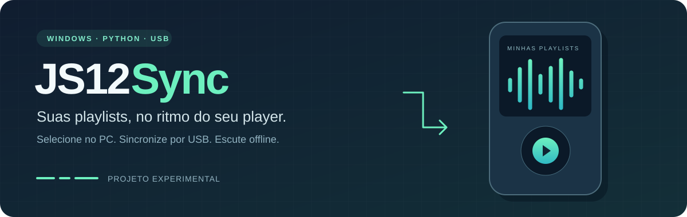

<div align="center">



<br />

[](#executar-os-testes)
[](https://www.python.org/downloads/)
[](#começar)
[](LICENSE)
[](#estado-do-projeto)

**Escolha suas playlists no PC. Leve os arquivos para o seu player USB.**

[Instalação completa](mp4-sync/README.md) · [Configurar Spotify](mp4-sync/README.md#configurar-o-spotify-pela-primeira-vez) · [Contribuir](CONTRIBUTING.md) · [Relatar um problema](https://github.com/pjz3650/JS12-Sync/issues)

</div>

## Um novo uso para o seu MP3/MP4

O **JS12 Sync** é um aplicativo Windows para organizar a transferência de músicas para um player JS-12. Ele consulta as playlists disponibilizadas à sua conta Spotify, oferece um menu de seleção no computador e prepara arquivos MP3 e listas M3U para copiar por USB.

Depois da transferência, a reprodução acontece no próprio player, sem conexão com a internet.

> **Como o áudio é obtido:** o Spotify fornece os metadados das playlists. O [spotDL](https://github.com/spotDL/spotify-downloader) busca correspondências em fontes externas YouTube Music/YouTube. O projeto não instala Spotify no aparelho e não exporta downloads do Premium. Use conteúdo que você tenha autorização para baixar.

## O que você pode fazer

| Escolher | Sincronizar | Levar com você |
| --- | --- | --- |
| Listar playlists e selecionar algumas ou todas as disponíveis à API. | Reutilizar o cache local e copiar MP3 com verificação de integridade. | Reproduzir os arquivos offline pelo menu original do player. |
| Manter a seleção salva no PC. | Ativar a transferência ao conectar o USB, com o programa aberto. | Compartilhar um mesmo MP3 entre várias listas, sem duplicar a faixa. |

A sincronização cria sua própria pasta `SPOTIFY_SYNC` e preserva as músicas existentes fora dela. Arquivos antigos não são removidos automaticamente para liberar espaço.

## Começar

Você precisa de **Windows**, **Python 3.13**, internet e um aplicativo pessoal no Spotify for Developers. Não há instalador ou `.exe` único nesta versão.

No PowerShell:

```powershell
git clone https://github.com/pjz3650/JS12-Sync.git
cd JS12-Sync/mp4-sync

py -3.13 -m venv .venv
.\.venv\Scripts\python.exe -m pip install -r requirements-lock.txt
.\.venv\Scripts\python.exe -m spotdl --download-ffmpeg
.\.venv\Scripts\python.exe -m spotdl --download-deno

.\.venv\Scripts\python.exe app.py
```

Nas próximas vezes, abra **Abrir JS12 Sync.cmd** na pasta `mp4-sync`.

### Conectar ao Spotify

1. No programa, abra **Configurar acesso** e entre no [painel de desenvolvedor do Spotify](https://developer.spotify.com/dashboard).
2. Crie um aplicativo e, em **Which API/SDKs are you planning to use?**, marque somente **Web API**.
3. Cadastre exatamente o Redirect URI:

   ```text
   http://127.0.0.1:8765/callback
   ```

4. Copie o **Client ID** para o JS12 Sync e autorize a leitura de playlists no navegador.
5. Escolha as playlists, conecte o aparelho compatível e clique em **Sincronizar agora**.

O programa usa OAuth PKCE e não pede Client Secret nem sua senha. As regras do Spotify para aplicativos pessoais podem limitar o acesso a determinadas playlists. [Veja o passo a passo e as limitações](mp4-sync/README.md).

## Estado do projeto

**Experimental, com validação offline.** A apresentação acima descreve o fluxo implementado; a validação completa em uso real ainda está pendente.

| Área | Situação |
| --- | --- |
| Interface Tkinter e seleção no PC | Implementadas; abertura da janela verificada |
| Cache e conversão MP3 de 128 kb/s | Implementados; verificados também com áudio sintético |
| Testes offline | 11 testes de arquivos, integridade, cache e respostas simuladas da API |
| Login real e sincronização de playlists | Precisam de validação com uma conta autorizada |
| Leitura de M3U no JS-12 | Precisa de confirmação no firmware do aparelho |
| Outros players | Precisam de adaptação da identificação USB no código |

**Compatibilidade:** a detecção atual está vinculada a uma unidade JS-12 específica com ATJ2127. Outro aparelho, mesmo do mesmo modelo, não será reconhecido automaticamente. Não depende de a letra da unidade ser `D:`. Consulte [como adaptar a identificação](mp4-sync/README.md#compatibilidade-e-outros-aparelhos).

Músicas curtidas, podcasts e execução de um menu personalizado no player não fazem parte desta versão. A busca externa também pode falhar ou encontrar uma gravação diferente.

## Dentro do projeto

```text
JS12-Sync/
├── docs/assets/banner.svg      # Identidade visual do README
├── mp4-sync/
│   ├── app.py                  # Interface, seleção e monitoramento USB
│   ├── spotify_access.py       # OAuth PKCE e consulta das playlists
│   ├── download_worker.py      # Busca e conversão em processo separado
│   ├── core.py                 # Identificação USB e cópia verificada
│   ├── test_sync.py            # Testes offline
│   └── README.md               # Manual de instalação e operação
├── CONTRIBUTING.md
└── LICENSE
```

Os dados de execução ficam em `%LOCALAPPDATA%\JS12Sync`: configuração, autorização protegida pelo Windows, cache de músicas e logs. Não são parte do repositório.

### Executar os testes

Na raiz do repositório, com o ambiente instalado:

```powershell
.\mp4-sync\.venv\Scripts\python.exe -m unittest discover -s mp4-sync -p test_sync.py -v
```

Eles não acessam sua conta Spotify nem escrevem em um aparelho físico. A suíte deve ser executada em Windows. Ainda não há execução automática configurada no GitHub Actions.

## Contribua

Encontrou um problema ou quer ajudar a suportar outro player? Consulte [CONTRIBUTING.md](CONTRIBUTING.md) e abra uma issue com passos para reproduzir. Revise os logs antes de compartilhá-los: nunca envie tokens, músicas ou dumps de firmware.

Use **`main`** para a versão integrada. As branches de sincronização USB, desktop Spotify, testes e documentação preservam os respectivos pontos do histórico de implementação.

## Licença e créditos

Distribuído sob a [licença MIT](LICENSE). Dependências e ferramentas mantêm suas próprias licenças.

Construído com Python, Tkinter, [Spotipy](https://github.com/spotipy-dev/spotipy), [spotDL](https://github.com/spotDL/spotify-downloader), FFmpeg e Deno.

Projeto independente, sem afiliação com Spotify, Actions Semiconductor ou YouTube.
